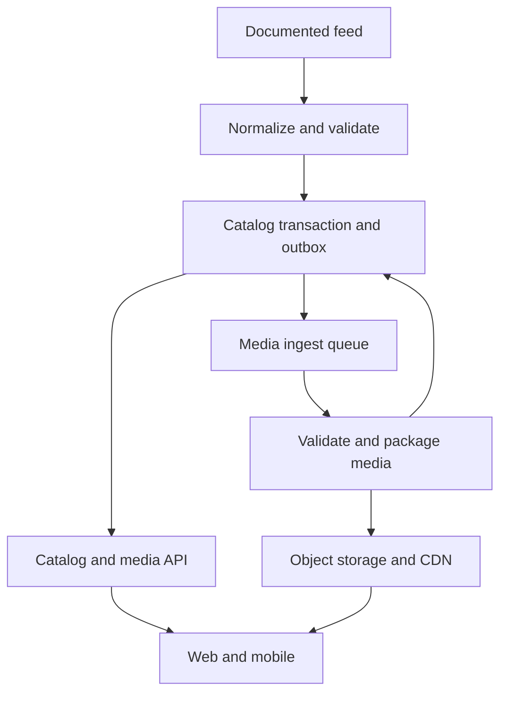

# Series Viral Box implementation plan

## Current baseline

The draft implementation uses npm workspaces and a lean Node.js loopback service with PostgreSQL. Next.js, Expo, NestJS, Prisma and the queue-backed worker below are target components. Local disk is the default media store. Object storage and CDN delivery are optional configuration. Web playback uses a blob URL backed by signed same-origin HLS. Treat public source discovery and complete production media rights as separate dependencies. See the [audit](AUDIT.md), [current state](STATE.md) and post-audit backlog for verification and rollout order.

## Outcome

One branded web and native mobile catalog with All Series and provider views, localization, episode playback from our local media origin or configured CDN, and per-episode downloads where distribution is supported. Web and app use the same catalog and playback API. Admin manages sources, freshness, reconciliation, asset status and rights windows. Initial production scope is one validated source, with additional sources onboarded independently. The target catalog covers every discoverable provider listed by ReelFren, DramaFren and comparable short-drama catalogs, plus providers found directly through official app and web listings. The pilot validates the pipeline before broader onboarding. The initial audience, languages, territories, monetization and native offline behavior remain product decisions.

## Architecture

| Component | Baseline | Responsibility |
| --- | --- | --- |
| Web and admin | Next.js App Router | Searchable public catalog, watch pages, operational dashboard |
| Mobile | Expo / React Native | iOS and Android catalog, player and account UI |
| API | NestJS on Node.js | Versioned REST/OpenAPI, catalog, playback/download grants, admin authorization |
| Persistence | PostgreSQL with Prisma | Metadata, source identity, rights, job records, active media versions |
| Background processing | Redis + BullMQ worker | Catalog sync, retries, outbox dispatch, media ingest and reconciliation |
| Media | FFmpeg, S3-compatible storage and CDN | Validation, HLS renditions, downloadable MP4 when allowed |

Target a TypeScript workspace with apps/web, apps/mobile, apps/api and apps/worker. Share generated API client, schema and tokens. Keep platform-specific view and player implementations in their apps. Start with PostgreSQL search and containerized services. Hosting vendor and production budgets remain open. AI drives development and design. Runtime catalog and media decisions use deterministic code.

## Source boundaries

ReelFren aggregates providers. DramaFren v2 has an editorial watch section and distinct DramaBox catalog. Provider subdomains show mixed access patterns, and most tested roots returned 403 in the audit environment. Provider coverage, full inventory and reusable media delivery are unverified. Record them as candidate discovery sources. Onboard production connectors against documented feeds and exportable masters with recorded hosting and download scope. Ship fixtures while access is unresolved.

Track source, provider, and version labels independently. Preserve localization and regional differences. Review cross-source matches using verified IDs or explicit mappings. A title name alone is insufficient.

## Data flow

1. Run bounded backfill and incremental sync per source. Page through the feed with checkpoints. Commit upserts and outbox events in one transaction. Advance checkpoints only after committed writes. Serialize reconciliation per source. Treat missing items as removals only after a successful authoritative scan or explicit tombstone.
2. Resolve by stable episode ID and source revision. Queue uniquely by source episode, revision and output profile. Validate rights before ingest. Stage the object, verify size, duration, format and checksum, and transcode with bounded resources. Switch the DB active asset pointer atomically only when all required objects pass verification. Clean abandoned uploads. Preserve a valid active version on a failed replacement.
3. API publishes catalog by provider, locale and availability. Playback and download grants verify asset state, region and rights on issuance. URLs expire within the distribution window. Explicit removal blocks new grants and triggers CDN invalidation or revocation where configured. Signed grants and source URLs never appear in logs.
4. Use contract fixtures and bounded checks to detect response changes. Back off on rate limits and isolate broken sources. Preserve the last valid catalog on schema or authentication failures. Alert with source, run, error class and last success. Patch the connector, validate it against fixtures and staging, then resume from the checkpoint.

## Data and contracts

- Identity: providers, sources, source_titles, source_episodes, canonical titles and episodes, localized titles and subtitle tracks. Unique keys use source ID and upstream ID plus variant when the feed scopes identifiers by locale.
- Media: rights grants capture territory, effective window, playback, rehosting and download separately. Assets carry checksum, storage key, revision, rendition type and verification state. Keep grant references and an auditable active version.
- Ops: sync_runs, sync_checkpoints, outbox, ingest_attempts and audit_events. Log identifiers and error classes. Track freshness, queue age, ingest failure and playback error rate. Admin actions require role checks.
- API baseline: GET /v1/providers, GET /v1/titles, GET /v1/titles/{id}, POST /v1/episodes/{id}/playback, POST /v1/episodes/{id}/download, and authenticated admin sync/health endpoints. Use cursor pagination and stable error codes. Track watch progress and bookmarks separately from catalog data.

## Verification and release

Run typecheck/lint/build, API contract checks, migration checks, and fixture integration tests in CI. Verify retries, concurrent duplicate jobs, partial sync, failed replacement, rights expiry and takedown. Stage a full series through web and native playback and download. Verify real target browsers and iOS/Android builds before release. Establish storage and egress budgets, backup restore, release rollback, and on-call ownership before launch.

See the [backlog](BACKLOG.md), [current state](STATE.md), and [design workflow](DESIGN.md).

## Catalog expansion

Use aggregator directories, official provider websites, and app-store publisher listings to discover providers and candidate title inventories. Record which site indexed an app and preserve provenance by source, provider, locale and upstream ID. Verify publisher identity and prefer the primary provider feed when several websites list the same content. Support scheduled discovery review, per-source incremental sync, coverage reporting, and reconciliation. Track catalog metadata including artwork, title, synopsis, episode list, language, region, update time and official viewing links. Track inventory, permission to reuse metadata/artwork, supported playback and downloadable media as independent capabilities. A source can contribute catalog records when metadata reuse is supported, and media is ingested only when a reusable file and distribution scope are verified.
